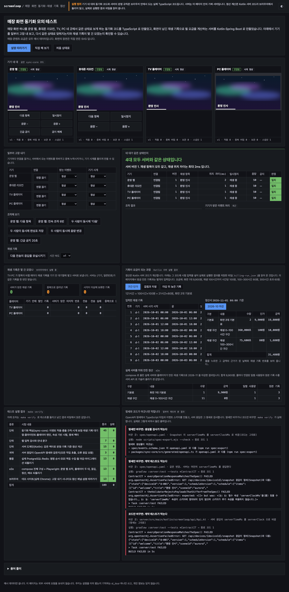
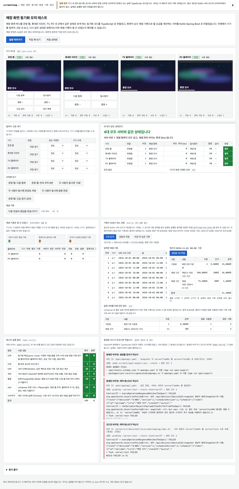
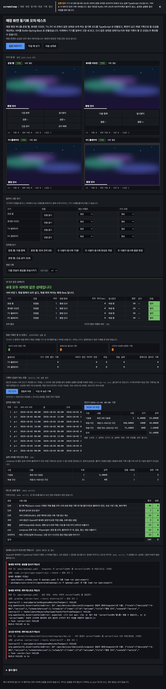
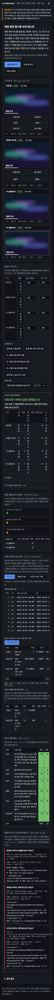
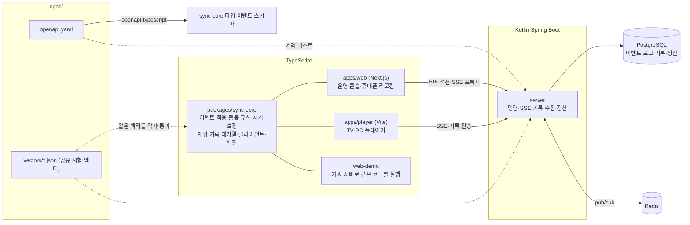

# Screenloop

매장 화면(TV·PC 플레이어)의 상태를 운영 웹과 휴대폰 리모컨까지 같은 상태로 맞추는 동기화 코드(TypeScript)와, 화면이 남긴 재생 기록으로 월 요금을 정산하는 서버(Kotlin·Spring Boot)를 만든 데모입니다. 매장·콘텐츠·요금은 모두 예시 데이터입니다.

**데모: https://choibongseok.github.io/screenloop/** — 기기 네 대를 일부러 고장 내 보는 페이지입니다(이벤트 순서 뒤바뀜·중복·누락, 연결 끊김, 기기 시계 차이, 동시 조작, 오프라인 재생 뒤 기록 전송).



| 라이트 | 1024px | 390px |
|---|---|---|
|  |  |  |

## 만든 범위

| | 프론트엔드(TypeScript) | 서버(Kotlin) |
|---|---|---|
| 한 일 | Next.js 운영 웹(화면 목록·편성표 편집·원격 조작·묶음 조작·재생 기록과 정산 미리보기·정산 근거 추적), 휴대폰 리모컨, 웹 플레이어, 동기화 핵심 `sync-core`, 데모 사이트 | 화면 상태·편성표·조작 명령 API, 이벤트 로그와 SSE, 재생 기록 수집, 일·월 집계와 요금 계산, 정산서와 근거 추적, 마이그레이션 |
| 시험 | 속성 기반 시험 포함 단위 시험, 웹 입력 검사, Playwright e2e | 같은 벡터로 판정·기록·정산 시험, 계약 시험, 실제 PostgreSQL·Redis 통합 시험 |
| 하지 않은 것 | React Native 앱(대신 같은 `sync-core` 를 쓰는 휴대폰 리모컨 웹 화면) | 결제사 연동, 실제 TV·셋톱 검증, 영상 인코딩·CDN |

## 구조



모노레포: `apps/web`, `apps/player`, `packages/sync-core`, `packages/scenes`(직접 만든 SVG 장면), `server`, `spec`, `web-demo`, `e2e`, `db/rollback`.

## 5분 실행

필요한 것: Docker, JDK 17~24(빌드는 Gradle 툴체인이 JDK 21 을 받아 씁니다), Node 24.

```
npm ci
make up        # 이미지 빌드 후 compose 로 서버·웹·플레이어·PostgreSQL·Redis 기동
```

- 운영 웹 http://127.0.0.1:59681 — `operator` / `operator-demo`(운영자), `viewer` / `viewer-demo`(보기 전용)
- 플레이어 http://127.0.0.1:59682/?device=d-001 (d-001 ~ d-004, 다른 기기와 같은 편성표를 보려면 같은 화면 묶음의 기기를 열면 됩니다. `&debug=1` 로 연결·대기 기록 표시)
- 휴대폰 리모컨 http://127.0.0.1:59681/remote/d-001
- 내리기: `make down`

호스트 포트는 59632(PostgreSQL), 59679(Redis), 59680(서버), 59681(웹), 59682(플레이어)입니다.

## 설계 결정

**상태를 누가 정하는가.** 화면 한 개의 상태(편성표, 지금 재생 항목과 위치, 일시정지, 음량, 긴급 공지)는 서버가 정합니다. 기기는 조작을 명령으로 보내고, 서버가 판정해 이벤트로 바꾼 뒤 모두에게 알립니다. 판정 규칙(`decide`)과 상태 전이(`reduce`)는 순수 함수이고 TypeScript 와 Kotlin 에 각각 있으며, 같은 시험 벡터를 통과해야 합니다.

**버전과 스냅샷.** 이벤트에는 화면마다 1부터 빠짐없이 이어지는 버전이 붙습니다. 기기는 `현재 버전 + 1` 인 이벤트만 적용하고, 앞 번호가 안 온 이벤트는 보관했다가 앞 번호가 오면 이어서 적용하고, 이미 적용한 번호는 버립니다. 보관만 쌓이고 앞 번호가 오지 않으면 스냅샷(상태 전체)을 다시 받습니다. 서버 하트비트에는 최신 버전이 실려 있어서, 마지막 이벤트가 유실돼 빠진 구간이 보이지 않는 경우도 따라잡습니다. 속성 기반 시험이 "이벤트가 어떤 순서·중복으로 와도 끝 상태가 서버와 같다"를 무작위 명령열로 확인합니다.

**충돌 규칙.** 서버가 도착 순서로 한 줄로 세웁니다(PostgreSQL 행 잠금, 이벤트 버전이 곧 순서). 절대값 명령(일시정지·재개·이동·음량·긴급 공지)은 나중에 도착한 쪽이 이깁니다. 같은 상태로 만드는 명령은 `unchanged` 로 거절하고 버전을 올리지 않습니다. "다음"은 조작자가 본 항목이 아직 재생 중일 때만 받고, 그 사이 다른 사람이 넘겼으면 `stale` 입니다. 편성표 저장은 조작자가 본 편성표 버전이 그대로일 때만 받습니다(먼저 저장한 쪽이 이기고 늦은 쪽은 `conflict`). 같은 `commandId` 를 다시 보내면 처음 결과를 그대로 돌려줍니다. 웹 콘솔은 서버 답을 기다리지 않고 같은 판정을 지역에서 먼저 적용해 보여 주고(낙관적 갱신), 서버가 거절하면 걷어냅니다.

**기기 시계 차이.** 재생 위치는 기기 시계가 아니라 서버 시각으로 계산합니다. 기기는 스냅샷을 받을 때마다 `서버 시각 − (보낸 시각 + 받은 시각) / 2` 로 시계 차이를 재고, 왕복이 가장 짧았던 표본을 씁니다. 시계가 갑자기 바뀌면 옛 표본을 버립니다. 1분마다 다시 잽니다.

**오프라인 재생과 기록의 멱등.** 플레이어는 편성표의 장면을 Cache Storage 에 미리 받아 두고, 연결이 끊겨도 마지막 편성으로 계속 재생합니다. 항목이 바뀌는 시각을 경계로 재생 기록을 만들어 기기 안 대기열에 쌓고(새로고침해도 일련번호가 이어집니다), 서버가 돌려준 `ackSeq` 까지만 지웁니다. 서버는 `(기기, 일련번호)` 유일 제약으로 같은 기록을 한 번만 받으므로, 응답이 유실돼 재전송해도 안전합니다. 일시정지 중이거나 긴급 공지가 화면을 덮은 동안은 편성 항목을 재생한 것으로 세지 않습니다.

**늦게 온 기록과 마감.** 길이가 0 이하이거나 6시간을 넘거나 서버 시각보다 5분 넘게 미래인 기록은 버리지 않고 `quarantined` 로 저장해 정산에서만 뺍니다. 월을 마감하면 그 정산서는 고치지 않습니다. 마감 뒤에 늦게 도착한 기록은 다음 정산서에 조정 항목(그 달을 다시 계산한 금액 − 이미 청구한 금액)으로 들어갑니다.

**정산 근거 추적.** 마감할 때 일별 사용량(기기·날짜·정산 초·원본 기록 번호)을 집계 실행 단위로 저장하고, 정산 줄이 근거가 된 일별 사용량을 가리킵니다. `GET /api/invoice-lines/{id}/trace` 가 줄 → 일별 사용량 → 원본 재생 기록을 돌려주고 운영 웹에서도 열 수 있습니다. 같은 기기에서 겹치는 구간은 한 번만 세고, 자정(한국 시간)을 넘는 기록은 날짜별로 나눕니다. 구간 단가는 구간마다 버림이고 금액은 원 단위 정수입니다. 집계는 입력 순서와 무관하게 같은 결과를 냅니다.

**명세와 코드를 묶은 방법.** `spec/openapi.yaml` 이 기준입니다. TypeScript 타입과 `spec/events.schema.json` 은 여기서 생성하고(`make spec`), 생성물이 어긋나면 `make verify` 가 막습니다. 서버 응답은 `ContractIT` 가 명세 스키마로 검사하고, 명세의 모든 작업을 호출했는지도 확인합니다. 판정·기록 기준·정산 규칙은 `spec/vectors/*.json` 을 두 언어가 각자 읽어 같은 결과를 내야 합니다. 일부러 명세만, 코드만 바꿔 본 실행 결과는 [docs/SPEC_DRIFT.md](docs/SPEC_DRIFT.md) 와 데모 사이트에 있습니다.

**서버·클라이언트 컴포넌트 경계(Next.js).** 목록·상세·기록·정산 페이지는 서버 컴포넌트가 서버 API 를 토큰 쿠키(httpOnly)로 읽어 그립니다. 실시간 상태와 조작이 필요한 부분(`DeviceGrid`, `DeviceConsole`, `ScheduleEditor`, `Remote`)만 클라이언트 컴포넌트입니다. 브라우저는 Kotlin 서버에 직접 가지 않고 Next 의 라우트 핸들러(스냅샷·SSE 프록시)와 서버 액션(조작·마감)을 거칩니다. 권한 판정은 항상 Kotlin 서버가 하고, 화면의 비활성 버튼은 안내일 뿐입니다.

## 배포 전 관문과 되돌리기

`make verify` 는 앞 단계가 실패하면 거기서 멈춥니다. CI 에 그대로 옮길 수 있는 단계입니다(이 저장소에는 CI 워크플로 파일이 없습니다).

1. 형식(prettier)·린트(eslint)·타입(tsc strict, Kotlin 컴파일)
2. 명세와 생성물(이벤트 스키마·TS 타입) 일치
3. 단위(TypeScript, Kotlin 순수 도메인)
4. 계약(서버 응답 ↔ OpenAPI)
5. 통합(실제 PostgreSQL·Redis)
6. e2e(compose 전체 + Playwright: 운영 웹 조작 → 플레이어 두 대 일치, 끊김·재접속, 오프라인 재생 뒤 기록 수집 → 정산, 배포 되돌리기)
7. 증거 수집, 명세 불일치 시험, 데모 사이트 빌드와 브라우저 시험
8. 테스트 케이스 문서 대조, 담당자 검사(`CODEOWNERS`: 경로마다 2명 이상, 기능마다 대응 가능한 사람 2명 이상)

배포는 `scripts/deploy.sh <버전>` 입니다. 이미지를 빌드해 교체하고 헬스 체크를 기다리며, 실패하면 직전 버전으로 자동으로 되돌립니다. 수동 되돌리기는 `scripts/rollback.sh` 입니다. 데이터베이스는 Flyway 로만 바꾸고 모든 마이그레이션에 되돌리는 스크립트(`db/rollback/U*.sql`)가 있어야 하며, 실제로 되돌린 뒤 다시 올라가는지 시험합니다. 자세한 규칙은 [docs/ROLLBACK.md](docs/ROLLBACK.md) 입니다.

## 테스트

109건(unit 67, integration 16, e2e 26). 명령은 `make test`(단위·계약·통합), `make e2e`, `make verify`(전부). 모든 행이 실제 테스트와 1:1 이고 `make verify` 가 실행 결과와 대조합니다. [docs/TEST_CASES.md](docs/TEST_CASES.md)

데모 사이트는 `make pages` 로 `gh-pages` 브랜치에 로컬 커밋합니다(push 는 하지 않습니다).

## 한계

- 이 저장소의 계정은 고정 계정 두 개(운영자·보기 전용)이고 기기 키도 고정값입니다. 실제 서비스라면 계정 저장소, 비밀번호 해시, 기기 등록이 필요합니다.
- 플레이어 연결 상태(`online`)는 서버 한 대의 메모리에 있는 SSE 연결 수로 판단합니다. 서버를 여러 대로 늘리면 연결 상태 저장 방식을 바꿔야 합니다(이벤트 전달은 Redis pub/sub 이라 여러 대에서도 됩니다).
- 실제 TV·셋톱 기기에서는 검증하지 않았고 Chrome(웹 플레이어)에서만 돌려 봤습니다. React Native 앱은 만들지 않았습니다.
- 재생 기록은 항목이 바뀌는 순간 끊습니다. 탭이 오래 멈춰 있다가 돌아오면 그 사이 건너뛴 항목은 기록되지 않습니다.
- 정산은 계정 한 개, 요금제 한 개, 월 단위만 다룹니다. 결제 연동은 없습니다. 환율·세금 계산은 없습니다.
- 데모 사이트의 서버는 브라우저 안의 가짜 서버입니다. 판정 규칙은 같은 TypeScript 구현이고 Kotlin 서버와의 일치는 공유 벡터로 확인합니다.
- 부하 시험과 장기 운영은 해 보지 않았습니다.
